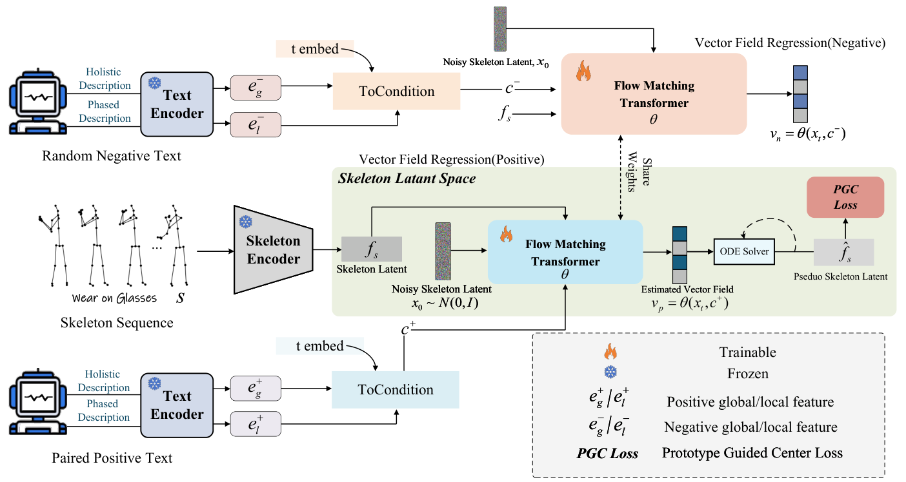

<h1 align="center">Beyond Alignment: A Generative Matching Paradigm via Flow Matching for Zero-Shot Skeleton-Based Action Recognition</h1>

<p align="center"><strong>ProtoFM · ECCV 2026 Poster</strong></p>

<p align="center">
  <a href="https://orcid.org/0009-0008-1749-2431">Xuan Liu</a> ·
  <a href="https://orcid.org/0000-0001-9555-9445">Cong Wu</a> ·
  <a href="https://orcid.org/0000-0003-0750-4749">Wei Fang</a> ·
  <a href="https://orcid.org/0000-0002-4485-4249">Zhenhua Feng</a><br>
  Jiangnan University
</p>

<p align="center">
  <a href="https://eccv.ecva.net/virtual/2026/poster/4234"></a>
  <a href="https://doi.org/10.1007/978-3-032-37086-0_1"></a>
</p>

---

This repo is the official implementation for **"Beyond Alignment: A Generative Matching Paradigm via Flow Matching for Zero-Shot Skeleton-Based Action Recognition"**, presented as a poster at **ECCV 2026**. ProtoFM learns to generate skeleton features conditioned on action semantics, then evaluates both zero-shot learning (ZSL) and generalized zero-shot learning (GZSL). The current training path uses a DiT-based flow model, a triplet objective, a prototype-guided center loss, and a prototype memory bank at evaluation time.

<p align="center">
  
</p>

<p align="center"><em>Overview of the ProtoFM framework.</em></p>

## Contents

- [Environment](#environment)
- [Data preparation](#data-preparation)
- [Training and evaluation](#training-and-evaluation)
- [Citation](#citation)

## Environment

Run all commands from the ProtoFM root, the directory containing `main_gzsl.py`. A CUDA-capable GPU is required by the current implementation. The experiment logs were produced in a Python 3.9 environment; exact package versions were not recorded in this repository.

```bash
conda create -n protofm python=3.9 -y
conda activate protofm

# Install a PyTorch build compatible with your CUDA driver first:
# https://pytorch.org/get-started/locally/
pip install numpy pandas PyYAML tqdm timm accelerate diffusers transformers safetensors
```

The code also downloads or loads the `tokenizer` and `text_encoder` components of `stabilityai/stable-diffusion-2-1-base` through Hugging Face Transformers. Set `pretrained_model_name_or_path` in the YAML file if you keep that model at a local path. Allow network access for the first download, or place the model files in the local path beforehand.

## Data preparation

ProtoFM consumes **pre-extracted skeleton features**, not raw skeleton sequences. [Flora's pre-extracted feature instructions](https://github.com/cseeyangchen/Flora#b-pre-extracted-features) describe a source for the SynSE feature archives used by the four example configurations. Obtain the datasets and any external feature files under their respective terms.

The `data/ntu60/`, `data/ntu120/`, and `data/pkummd/` directories are copied from [Flora's `data/` directory](https://github.com/cseeyangchen/Flora/tree/5ce56fdafd58a5cdd144554b2b381c19855e52d7/data). They contain raw-skeleton preprocessing scripts and dataset statistics. They do not include the pre-extracted features required by the four configurations below.

The four YAML files in `config/` expect these directories:

| YAML file | Feature directory | Unseen-label file |
| --- | --- | --- |
| `config/flow_ntu60_unseen5.yaml` | `data/synse_features/ntu60_s55_u5/` | `data/label_splits/ntu60/ru5.npy` |
| `config/flow_ntu60_unseen12.yaml` | `data/synse_features/ntu60_s48_u12/` | `data/label_splits/ntu60/ru12.npy` |
| `config/flow_ntu120_unseen10.yaml` | `data/synse_features/ntu120_s110_u10/` | `data/label_splits/ntu120/ru10.npy` |
| `config/flow_ntu120_unseen24.yaml` | `data/synse_features/ntu120_s96_u24/` | `data/label_splits/ntu120/ru24.npy` |

Each feature directory must contain the files read by `feeders/feeder.py`:

```text
data/synse_features/ntu60_s55_u5/
├── train.npy        # Seen-class training features: [N, 256]
├── train_label.npy  # Training class IDs: [N]
├── ztest.npy        # Unseen-class ZSL test features: [M, 256]
├── z_label.npy      # ZSL test class IDs: [M]
├── gtest.npy        # Seen + unseen GZSL test features: [K, 256]
└── g_label.npy      # GZSL test class IDs: [K]
```

Class IDs must be zero-based and consistent across the features, unseen-label array, and text descriptions. If your features are distributed as an `.npz` archive, extract its `train`, `train_label`, `ztest`, `z_label`, `gtest`, and `g_label` arrays into the matching directory as individual `.npy` files. The feature loader uses the exact filenames shown above.

The current `train.py` also reads both of these text files for **all NTU configurations**:

```text
data/class_lists/ntu120.csv      # A `label` column, ordered by class ID
data/class_lists/ntu120_llm.txt  # One description per class, in the same order
```

Provide both files with 120 aligned entries. The code indexes their joint text embeddings by numeric class ID. The pre-extracted feature data, unseen-label arrays, and class descriptions are not included in this repository.

## Training and evaluation

`main_gzsl.py` trains and evaluates at the end of **every epoch**. It reports ZSL accuracy, GZSL seen/unseen accuracy, calibrated gamma, and the harmonic mean `H`. Pass `--num-epoch` explicitly: the YAML files in `config/` do not set it, and the parser default is only one epoch. Use a fresh `--work-dir` for each run because log files are opened in append mode.

```bash
# NTU RGB+D 60: 55 seen / 5 unseen; use physical GPU 0
python main_gzsl.py --config config/flow_ntu60_unseen5.yaml \
  --num-epoch 100 --gpu 0 --work-dir ./flow/results/ntu60/unseen5_new

# NTU RGB+D 60: 48 seen / 12 unseen
python main_gzsl.py --config config/flow_ntu60_unseen12.yaml \
  --num-epoch 100 --gpu 0 --work-dir ./flow/results/ntu60/unseen12_new

# NTU RGB+D 120: 110 seen / 10 unseen
python main_gzsl.py --config config/flow_ntu120_unseen10.yaml \
  --num-epoch 100 --gpu 0 --work-dir ./flow/results/ntu120/unseen10_new

# NTU RGB+D 120: 96 seen / 24 unseen
python main_gzsl.py --config config/flow_ntu120_unseen24.yaml \
  --num-epoch 100 --gpu 0 --work-dir ./flow/results/ntu120/unseen24_new
```

The 100-epoch count is an example; adjust it for each main experiment. `--gpu` selects a physical GPU through `CUDA_VISIBLE_DEVICES`. After selection, that GPU is device 0 inside the process.

Each run writes `train_log.txt` and `val_log.txt` to `work_dir`. The `best/` accelerator checkpoint is selected by **GZSL H**, while ZSL accuracy is recorded separately in `val_log.txt`. Periodic `checkpoint-<step>/` directories are controlled by `save_iter`. GZSL evaluation searches the calibration gamma that maximizes H for each epoch; the logged `Cal_gamma` is the selected value.

There is currently no separate checkpoint-only evaluation command. The `phase` field does not switch `main_gzsl.py` into a test-only path.

## Citation

If you use ProtoFM in your research, please cite:

```bibtex
@inproceedings{liu2026beyond,
  title     = {Beyond Alignment: A Generative Matching Paradigm via Flow Matching for Zero-Shot Skeleton-Based Action Recognition},
  author    = {Liu, Xuan and Wu, Cong and Fang, Wei and Feng, Zhenhua},
  booktitle = {Computer Vision -- ECCV 2026},
  series    = {Lecture Notes in Computer Science},
  volume    = {17059},
  pages     = {1--18},
  year      = {2026},
  publisher = {Springer},
  doi       = {10.1007/978-3-032-37086-0_1}
}
```

## Acknowledgement

This repo is based on Shift-GCN and TDSM. Part of the pre-trained skeleton features is derived from SynSE and SA-DAVE. The semantics for the NTU-series datasets are partially obtained from SA-DAVE. The scripts and statistics in `data/` are copied from Flora with permission, with the source files' existing notices retained.

Thanks to the authors for their work!
